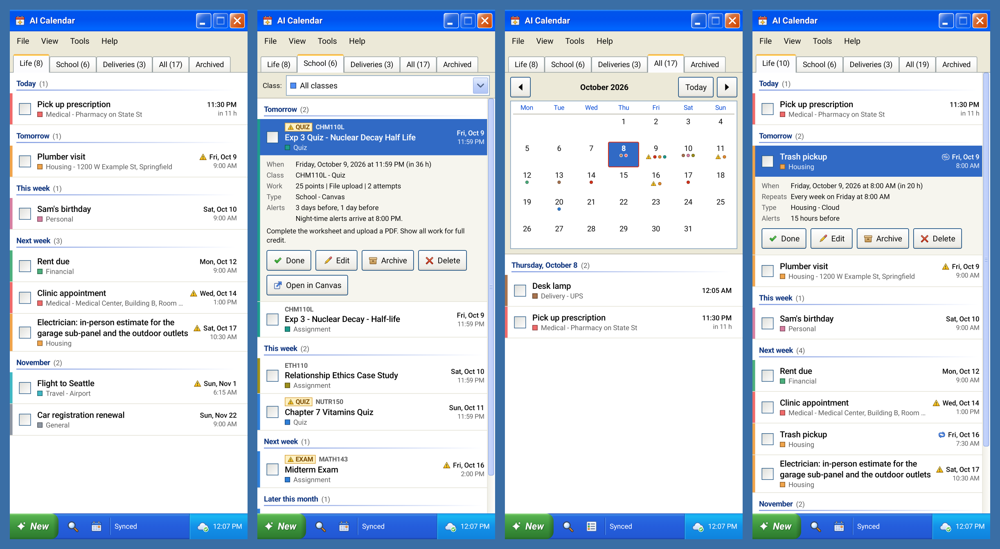
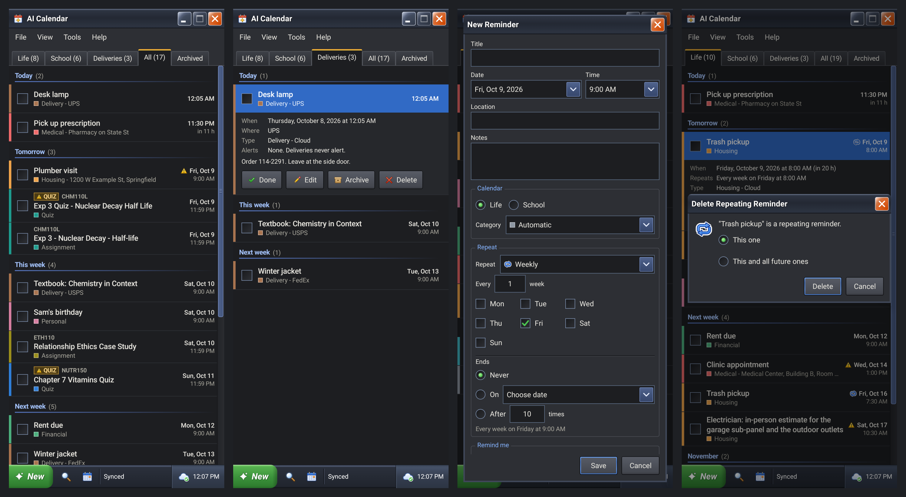
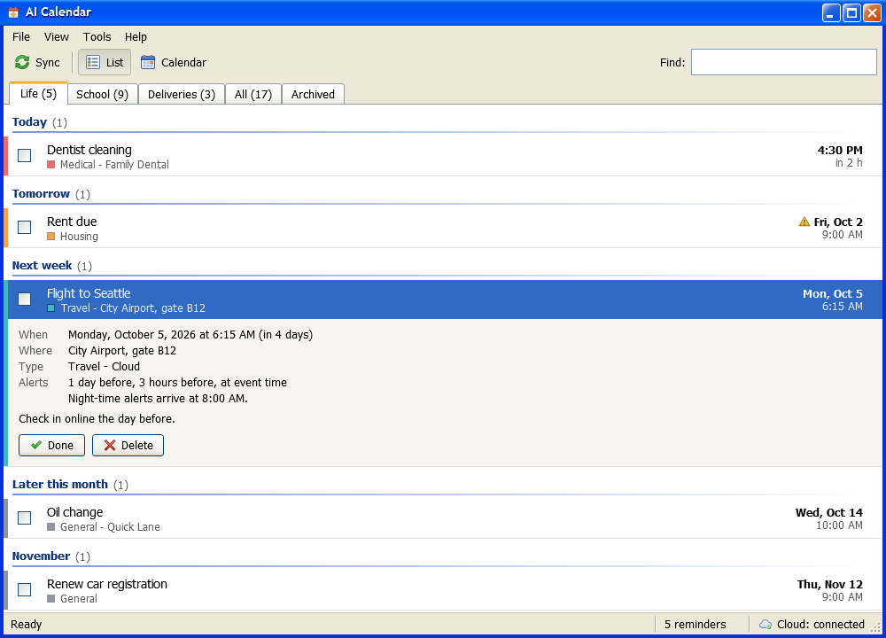

# AI Calendar

A personal reminder system that AI assistants can write to. An Android app and a Windows app
share one cloud calendar; a Firebase backend stores it and exposes it to AI clients (Claude, or
any MCP client) through a remote MCP server secured with OAuth 2.1. Every screen is styled like
Windows XP, with original artwork.





The screenshots are rendered by the projects' own UI tests from made-up sample reminders.

## What it does

- **AI clients publish reminders.** An assistant reading your mail or a task result calls
  `publish_task_reminders`; stable task and item keys update instead of duplicating, and a
  reminder you deleted stays deleted.
- **Phone alerts you never miss.** Exact alarms for critical reminders, day-before notices, Done /
  Snooze / Ignore actions, re-armed after reboot. A night rule moves advance notices out of 9 PM to
  8 AM.
- **Feeds:** Life, School and Deliveries tabs, plus All and Archived. Deliveries are only listed
  and never alert. Birthdays and deliveries stay listed all day.
- **Repeating reminders:** daily, weekly on chosen weekdays, monthly or yearly, every N, ending
  never, on a date or after N times. The server turns each series into ordinary reminders for the
  next 60 days; editing or deleting one asks "This one" or "This and all future ones".
- **Canvas LMS:** assignments, quizzes and discussions imported every 30 minutes, with course
  colors, points, submission types and quiz/exam warnings.
- **Outlook.com mail tools (optional):** list, read, move, file into folders and create move-only
  Inbox rules through Microsoft Graph, so an assistant can triage mail. Nothing ever deletes mail.
- **Windows companion:** list and month views, Find, class filter, balloons while it runs, dark
  mode.

## Repository

| Folder | What |
|---|---|
| `app/` | Android app. Kotlin, Jetpack Compose, `minSdk 26` |
| `desktop/` | Windows companion. .NET 8, WPF, xUnit tests that never show a window |
| `bridge/` | Firebase Functions backend in TypeScript: device sync API, MCP server, OAuth, Canvas, Outlook |
| `ui-harness/` | Headless Robolectric + Roborazzi harness that renders every phone screen and drives UI flows |
| `tools/xp-icons/` | Generator for all icons (phone, Windows, launcher) from one Python definition file |
| `scripts/` | PowerShell helpers: build and test the phone app, test and install the Windows app, deploy |
| `docs/` | Setup guides, architecture, screenshots |

## Set it up

You need your own Firebase project (Blaze plan, for Cloud Functions and Cloud Scheduler) and,
for the optional mail tools, a Microsoft Entra app registration.

1. [docs/SETUP-FIREBASE.md](docs/SETUP-FIREBASE.md): project, Firestore, Functions, secrets, the
   Android app registration, deploy.
2. [docs/SETUP-AZURE.md](docs/SETUP-AZURE.md): the Microsoft app for Outlook.com mail (optional).
3. Build and install the phone and Windows apps, pair them, and connect an AI client:
   [docs/SETUP-FIREBASE.md#connect-the-apps-and-an-ai-client](docs/SETUP-FIREBASE.md#connect-the-apps-and-an-ai-client).

Handing the work to a coding agent (Claude Code, Codex and others)? Point it at
[AGENTS.md](AGENTS.md). It has the setup playbook, the commands, and the rules that keep the two
apps and the server consistent.

## How it fits together

```
 AI clients (MCP over HTTPS, OAuth 2.1 + PKCE)      Canvas LMS          Outlook.com
                    |                                    | every 30 min      | Microsoft Graph
                    v                                    v                   v
 +----------------------------------------------------------------------------------+
 |  bridge/  Firebase Functions: `api` (Express + MCP server), `canvasSync` (cron)  |
 |  Firestore: events, series, devices, oauth*, integrations                        |
 +----------------------------------------------------------------------------------+
        | FCM "revision changed" signal (no content)          ^
        | GET /v1/sync, PATCH/DELETE /v1/events, /v1/series    | same API, polled every 60 s
        v                                                      |
 app/  Android: alarms, notifications              desktop/  Windows: list, balloons
```

More in [docs/ARCHITECTURE.md](docs/ARCHITECTURE.md).

## Tests

| Suite | Command (from the repository root) |
|---|---|
| Bridge | `cd bridge`, `npm ci`, `npm test` |
| Phone unit tests, lint, APK | `scripts/build-app.ps1 :app:testDebugUnitTest :app:lintDebug :app:assembleDebug` |
| Phone screens (pictures in `ui-harness/build/shots`) | `ui-harness/run.ps1` |
| Windows | `scripts/test-desktop.ps1` |

## Security notes

- Nothing secret is in the repository. Secrets live in Firebase Secret Manager; local copies go in
  ignored files (`secrets/`, `bridge/.env.*`).
- The phone and the PC pair with a pairing code and get a device token; the server keeps only its
  SHA-256 hash. FCM messages carry a revision number, never reminder content.
- AI clients sign in with OAuth 2.1 (dynamic client registration, PKCE); the consent page asks for
  the pairing code.
- Firestore rules deny all client access; only the functions read and write.
